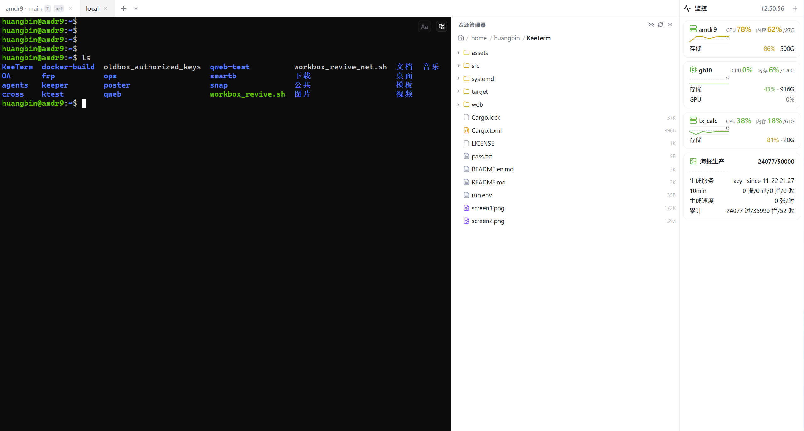
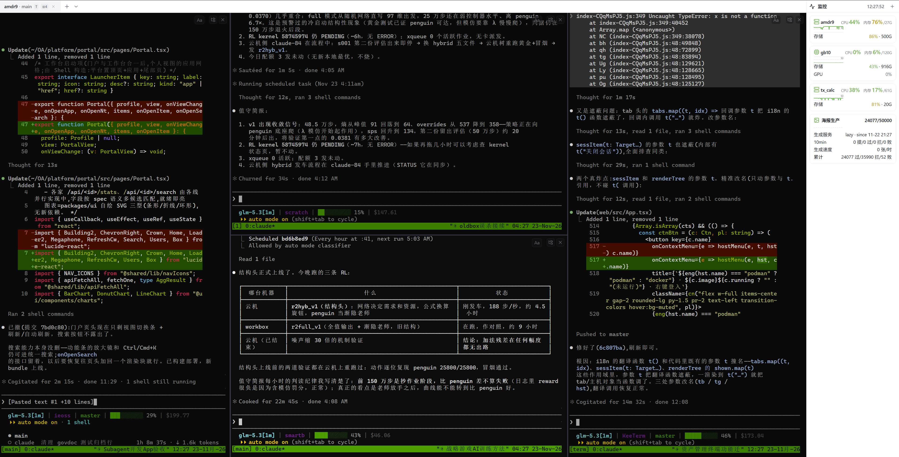

# KeeTerm

English | [中文](README.md)

**Standalone web terminal · your `~/.ssh/config` is the host list · containers / tmux / file workbench.**





A single Rust binary with the frontend embedded — the VSCode Remote philosophy:
the ssh config you already have *is* the target registry. Zero server-side setup,
zero protocol libraries (pure ssh-client orchestration).

```
$ keeterm 7697 --auth-file pass.txt
```

## Quick start

- **`+`** (tab bar): new local shell tab
- **`∨` dropdown**: host/container tree — **click** to expand containers, **right-click** to connect
- **Add hosts**: "Edit ssh config" at the bottom of the dropdown edits `~/.ssh/config` directly;
  the list refreshes on save. `targets.toml` only holds extras (notes/passwords/ports)

### Connecting & modifier keys

The right-click menu (SSH login / tmux sessions / new tmux / container shell) supports:

| Action | Behavior |
|---|---|
| Click | new tab |
| **Shift + click** | split **right** of the focused pane |
| **Alt + click** | split **below** the focused pane |

- Splits **nest** (iTerm style); dividers are draggable (15%–85%); the focused pane is highlighted
- Per-pane button row: `Aa` font/theme · file tree · `×` close (`Ctrl+D` works too)
- Every pane is a full workbench: **terminal | preview | file tree**; the tree's working dir is remembered per connection
- **tmux sessions live on the host**: closing a tab or losing connection doesn't kill them — reattach anytime

### File workbench

- Tree: streaming pagination for huge dirs (60k entries in under a second), context menu for create/delete/rename/upload/download, directories download as tar.gz
- Preview: text / **Markdown** (inline SVG, relative-path images) / PDF / images / sandboxed HTML
- Editing: text & Markdown are editable (CodeMirror core, no syntax highlighting to stay lean); `Ctrl+S` saves back to the remote

### Tab status badges

- Spinner = output flowing in a background pane (running)
- Pulsing red dot = silent for 4s (done / awaiting you); clears when you look at it
- Tiny output (tmux status-bar clock) doesn't count as unread

## Mobile

Just open it in a phone browser (responsive layout):

- **Drag** the terminal to scroll; **PgUp/PgDn** pages through tmux history (copy-mode)
- Bottom key bar: Esc / arrows / Tab / sticky **Ctrl** (Ctrl+C) / ⌨ to dismiss the keyboard
- Swipe the tab bar horizontally; **long-press a tab** to drag-reorder
- Keyboard/mouse activity feeds keepalives: idle timers restart on activity, so the link stays up while you're there

## Monitor side panel

- Host cards: big CPU/mem numbers + **2h CPU sparkline** + GPU/disk rows (15s polling)
- URL probe cards: `{rows,bar,value}` protocol or raw JSON (auto-flattened); self-signed certs OK
- `+` to configure (pick targets, name+URL probes); applies instantly; cards are drag-sortable

## Deployment

```
$ cargo build --release          # embeds web/dist (frontend: cd web && npm run build)
$ ./target/release/term-gateway 7697 --auth-file pass.txt
```

- Auth: code-server style single password; editing the password file takes effect immediately
  (old sessions are revoked); the cookie is derived from the password, so restarts keep you logged in
- See `systemd/` for a unit file; use frp/reverse proxy + a strong password on the public internet

---

[https://github.com/hb9630/KeeTerm](https://github.com/hb9630/KeeTerm) · Contact: [h9630@qq.com](mailto:h9630@qq.com)
