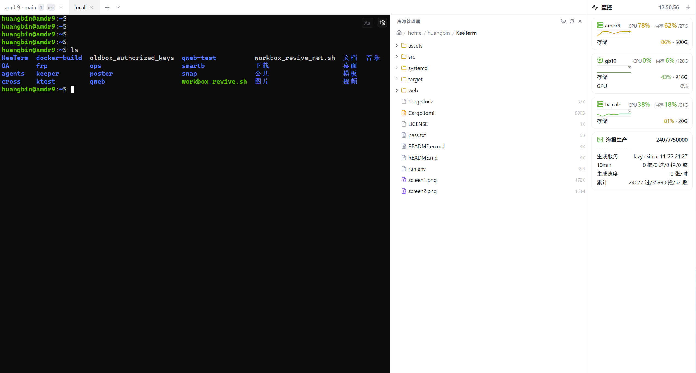
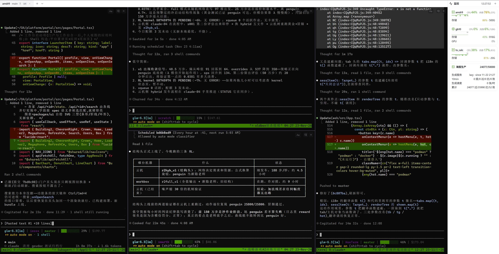

# KeeTerm

**Standalone web terminal · your `~/.ssh/config` is the host list · containers / tmux / file workbench.**
**独立 Web 终端 · ssh config 即目标 · 容器 / tmux / 文件工作站。**

A single Rust binary with the frontend embedded — the ssh config you already have *is* the
target registry. Zero server-side setup, zero protocol libraries (pure ssh-client orchestration).

Rust 单二进制(前端内嵌):已装好的 `~/.ssh/config` 就是主机清单,零服务端安装、零协议库(纯编排 ssh 客户端)。





```
$ keeterm 7697 --auth-file pass.txt
```

---

## English

### Quick start

- **`+`** (tab bar): new local shell tab
- **`∨` dropdown**: host/container tree — **click** to expand containers, **right-click** to connect
- **Add hosts**: "Edit ssh config" at the bottom of the dropdown edits `~/.ssh/config` directly;
  the list refreshes on save. `targets.toml` only holds extras (notes/passwords/ports)

### Connecting & modifier keys

The right-click menu (SSH login / tmux sessions / new tmux / container shell) supports:

| Action | Behavior |
|---|---|
| Click | new tab |
| **Shift + click** | split **right** of the focused pane |
| **Alt + click** | split **below** the focused pane |

- Splits **nest** (iTerm style); dividers are draggable (15%–85%); the focused pane is highlighted
- Per-pane button row: `Aa` font/theme · file tree · `×` close (`Ctrl+D` works too)
- Every pane is a full workbench: **terminal | preview | file tree**; the tree's working dir is remembered per connection
- **tmux sessions live on the host**: closing a tab or losing connection doesn't kill them — reattach anytime

### File workbench

- Tree: streaming pagination for huge dirs (60k entries in under a second), context menu for create/delete/rename/upload/download, directories download as tar.gz
- Preview: text / **Markdown** (inline SVG, relative-path images) / PDF / images / sandboxed HTML
- Editing: text & Markdown are editable (CodeMirror core, no syntax highlighting to stay lean); `Ctrl+S` saves back to the remote

### Tab status badges

- Spinner = output flowing in a background pane (running)
- Pulsing red dot = silent for 4s (done / awaiting you); clears when you look at it
- Tiny output (tmux status-bar clock) doesn't count as unread

### Mobile

Just open it in a phone browser (responsive layout):

- **Drag** the terminal to scroll; **PgUp/PgDn** pages through tmux history (copy-mode)
- Bottom key bar: Esc / arrows / Tab / sticky **Ctrl** (Ctrl+C) / ⌨ to dismiss the keyboard
- Swipe the tab bar horizontally; **long-press a tab** to drag-reorder
- Keyboard/mouse activity feeds keepalives: idle timers restart on activity, so the link stays up while you're there

### Monitor side panel

- Host cards: big CPU/mem numbers + **2h CPU sparkline** + GPU/disk rows (15s polling)
- URL probe cards: `{rows,bar,value}` protocol or raw JSON (auto-flattened); self-signed certs OK
- `+` to configure (pick targets, name+URL probes); applies instantly; cards are drag-sortable

### Deployment

```
$ cargo build --release          # embeds web/dist (frontend: cd web && npm run build)
$ ./target/release/term-gateway 7697 --auth-file pass.txt
```

- Auth: code-server style single password; editing the password file takes effect immediately
  (old sessions are revoked); the cookie is derived from the password, so restarts keep you logged in
- See `systemd/` for a unit file; use frp/reverse proxy + a strong password on the public internet

---

## 中文

### 快速上手

- **`+`**(tab 头):新开本机终端
- **`∨` 下拉**:主机/容器树——**左键**展开容器,**右键**选连接方式
- **登记主机**:下拉底部「编辑 ssh config」直接改 `~/.ssh/config`,保存后列表即时刷新;`targets.toml` 只存增强项(备注/密码/端口)

### 连接与修饰键

右键菜单(SSH 登入 / tmux 会话 / 新建 tmux / 容器登入)统一支持:

| 操作 | 行为 |
|---|---|
| 点击 | 新 tab |
| **Shift + 点击** | 在当前焦点面板**右侧**拆分登入 |
| **Alt + 点击** | 在当前焦点面板**下方**拆分登入 |

- 分屏可**继续嵌套拆分**(iTerm 式),分隔条可拖(15%~85%),焦点面板有亮框
- 面板右上按钮组:`Aa` 字体/主题 · 文件树 · `×` 关面板(`Ctrl+D` 同效)
- 每个面板都是完整三栏:**终端 | 文件预览 | 文件树**;树的工作目录按连接记忆
- **tmux 会话在目标机运行**:断线/关 tab 不散场,重连即恢复现场

### 文件工作站

- 文件树:远端目录流式分页(6 万条目录亚秒),右键新建/删除/重命名/上传/下载,目录打 tar.gz
- 预览:文本 / **Markdown 渲染**(含内联 SVG、引用式图片按相对路径取)/ PDF / 图片 / HTML 沙箱
- 编辑:文本/Markdown 可编辑(CodeMirror 内核,无语法高亮保持轻量),`Ctrl+S` 保存回远端

### 终端状态标(tab 头)

- 转圈 = 后台面板有输出(运行中)
- 红点呼吸 = 静默 4 秒(干完/等确认),切过去看即清
- 微输出(tmux 状态栏时钟)不算未读

## 手机

浏览器直接开(自适应布局):

- 终端区**拖动**回滚;**PgUp / PgDn** 翻 tmux 历史(copy-mode)
- 底部辅助键条:Esc / 箭头 / Tab / **Ctrl 粘滞**(Ctrl+C 中断)/ ⌨ 收起软键盘
- tab 条横滑切换;**长按 tab** 拖动排序
- 键鼠活动即保活:空闲超时按最后活动重算,人在终端前连接不断

### 监控右栏

- 主机资源卡:CPU/内存大字 + **CPU 近 2h 曲线** + GPU/存储行(15s 采集)
- URL 探针卡:`{rows,bar,value}` 协议或任意 JSON(自动拍平),自签证书可用
- `+` 配置(主机选 targets、探针填名称+URL),保存即生效,卡片可拖拽排序

### 部署

```
$ cargo build --release          # 自动嵌入 web/dist(前端:cd web && npm run build)
$ ./target/release/term-gateway 7697 --auth-file pass.txt
```

- auth:code-server 式单密码;改密码文件即时生效(旧会话作废);cookie 由密码派生,重启不掉线
- systemd 示例见 `systemd/`;公网建议 frp/反代 + 强密码

---

[https://github.com/hb9630/KeeTerm](https://github.com/hb9630/KeeTerm) · Contact: [h9630@qq.com](mailto:h9630@qq.com) · 联系:[h9630@qq.com](mailto:h9630@qq.com)
